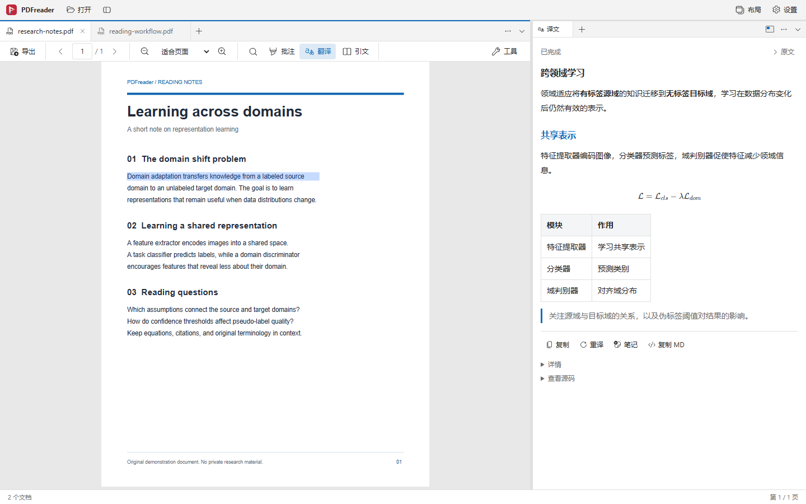
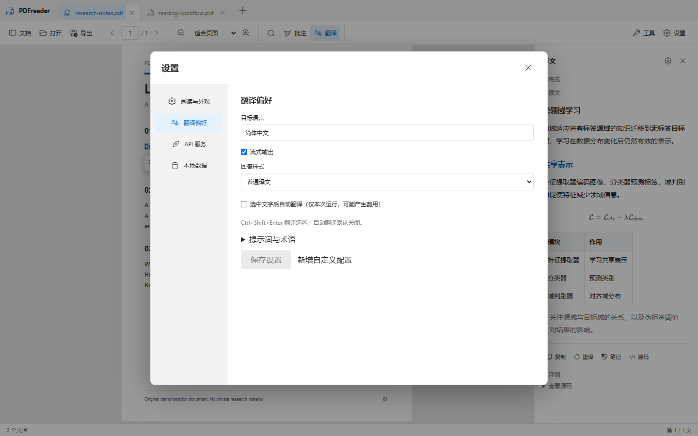

# PDFreader

面向文献阅读的 Windows 本地文档工作区，支持 PDF 阅读与批注、Markdown 笔记和 TXT 编辑。

A local Windows workspace for reading and annotating PDFs, writing Markdown notes, and editing plain text.

[下载 PDFreader](https://github.com/MPomelo/PDFreader/releases/latest) · [使用说明](docs/WORKSPACE_TABS_AND_SETTINGS.md) · [构建与贡献](CONTRIBUTING.md) · [隐私说明](docs/PRIVACY.md)



*截图使用项目自制示例 PDF；右侧译文为明确模拟的演示响应，不代表真实 API 测试结果。*

## 功能

- **多文档标签**：同一窗口打开或拖入 PDF、Markdown 和 TXT，PDF 标签分别保留页码、缩放、选区、批注和译文。
- **Markdown 笔记**：源码编辑、即时预览与左右分栏，离线排版公式，支持表格、任务清单、代码高亮及图片附件。
- **TXT 编辑**：纯文本显示、撤销重做、查找替换、自动换行；状态栏显示行列号、编码和换行格式。
- **阅读与批注**：目录、缩略图、查找、旋转、打印、高亮、下划线、删除线、文本、画笔与独立注释。选中文字后右键可快速复制、标注或翻译。
- **链接预览**：鼠标停在 PDF 内部链接上可查看图表、参考文献条目或目标页，点击跳转到原链接的位置。
- **保留原件**：导出带批注的 PDF 副本；关闭标签或整窗时检查未保存修改，支持保存、放弃、取消。
- **选区翻译**：流式输出、取消、Markdown 与常见数学排版；原始 Markdown 可复制并保存为笔记。
- **简洁工作区**：浮窗可固定到侧栏，两侧宽度可调；集中设置、浅深主题、窄窗与专注阅读模式。
- **本地数据**：阅读恢复、最近文件、按文档隔离的翻译缓存、独立笔记及 Markdown 导出。



## 安装与开始

当前源码版本为 **2.2.0**，适用于 Windows 10/11 x64。[查看版本说明](docs/RELEASE_NOTES.md)。

1. 在 [最新发行版](https://github.com/MPomelo/PDFreader/releases/latest) 下载 x64 的 `-setup.exe`，核对同版本 SHA256SUMS。
2. 运行安装程序。应用使用 Microsoft Edge WebView2 Runtime；已有运行时可离线阅读，缺失时安装程序需要联网下载安装运行时。日常使用无需 Node.js 或 Python。
3. 点击“打开”选择文档，或通过“＋”新建 Markdown 和 TXT。PDF 也可从资源管理器的“打开方式”打开。
4. 需要翻译时，在“设置 → API 服务”配置服务和密钥，保存后选择文字，按 Ctrl+Shift+Enter。

安装包目前未做代码签名，Windows 可能显示未知发布者提示。只在确认下载来源与校验和后继续。翻译使用你配置的外部 API，费用与隐私规则由对应服务决定；自动翻译每次启动默认关闭。

| 快捷键 | 操作 |
| --- | --- |
| Ctrl+O | 打开文档 |
| Ctrl+S | 保存文本或导出带批注的 PDF |
| Ctrl+Shift+S | 另存为 |
| Ctrl+F | 查找，文本标签支持替换 |
| Ctrl+Tab / Ctrl+Shift+Tab | 后一个 / 前一个标签 |
| Ctrl+1…8 / Ctrl+9 | 指定标签 / 最后一个标签 |
| Ctrl+W | 关闭当前标签 |
| Ctrl+Shift+Enter | 翻译当前选区 |

## 从源码构建

需要 Node.js 24+、Rust 1.90+、Visual Studio C++ 工具链与 Windows SDK，以及 WebView2 Runtime。

```powershell
git clone https://github.com/MPomelo/PDFreader.git
cd PDFreader
npm ci
npm run desktop:dev
# 独立 EXE / 主要分发安装包
npm run desktop:build
npm run desktop:bundle
```

安装包输出到 `src-tauri/target/release/bundle/nsis/`。阅读内核、Worker、图标、Markdown 与数学字体均随应用分发。开发、测试与许可再生成命令见 [CONTRIBUTING](CONTRIBUTING.md)。Windows CI 会运行本地检查并构建安装包，不调用付费 API，也不会自动发布正式版本。

技术栈：Tauri 2 / Rust、React / TypeScript、固定版本 PDF.js、Fluent 20 Regular、CodeMirror 6、Markdown / KaTeX。当前仅承诺 Windows x64；未提供 OCR、全文翻译、云同步、复杂 PDF 结构编辑或完整上次标签会话恢复。

## 开源与来源

项目自有代码采用 [MIT](LICENSE)。PDF.js、Fluent 图标及其他依赖各自保留原许可，详见 [NOTICE](NOTICE)、[来源记录](docs/REFERENCES.md)和 [第三方许可](public/licenses)。PDFgear 仅作为交互分组参考，未复制其源码、品牌或素材。

欢迎提交可复现的问题或改进。请使用自制[演示文档](docs/assets/research-notes.pdf)，不要公开上传密钥、私人论文或个人阅读记录。
